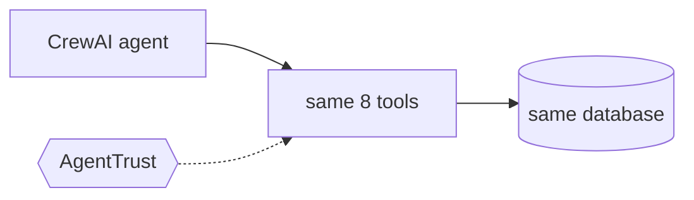

# Refund Bot on CrewAI

Not built yet. This will be the same agent as [`python/`](../../python/), with a [CrewAI](https://docs.crewai.com/) agent doing the work.

It uses the same tickets, the same tools and the same scenarios, so the AgentTrust modules show the same
protections on a CrewAI agent.
