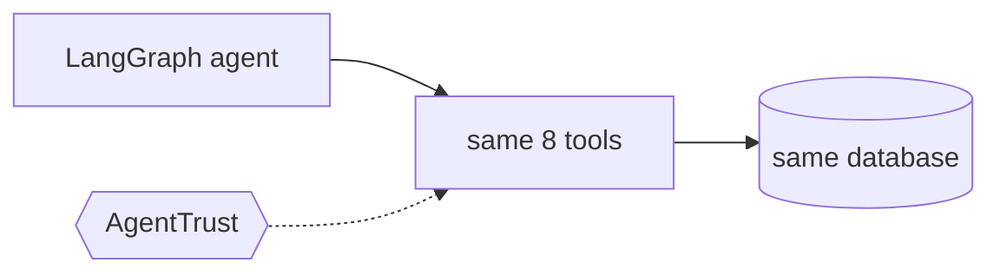

# Refund Bot on LangGraph

Not built yet. This will be the same agent as [`python/`](../../python/), with [LangGraph](https://langchain-ai.github.io/langgraph/) running the loop.

It uses the same tickets, the same tools and the same scenarios, so the AgentTrust modules show the same
protections on a LangGraph agent.
