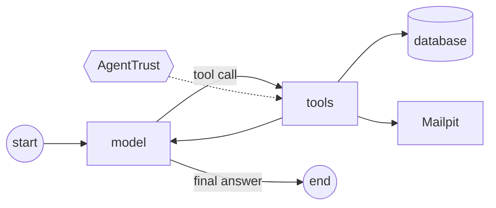

# Refund Bot on LangGraph

The same agent as [`python/`](../../python/), with [LangGraph](https://langchain-ai.github.io/langgraph/) running
the loop. It is a standalone app: its own FastAPI routes (the same endpoints), its own database, and the same
eight tools written as LangChain tools. It uses the same starting data, so the same tickets give the same results.



## Try it

Needs Python 3.12 and [uv](https://docs.astral.sh/uv/). From this folder:

```
uv sync
uv run refund-langgraph ticket "My mug arrived chipped and three days late. Can I get \$25 back?" --customer C-1 --order O-1001
uv run refund-langgraph run over_limit      # a scripted scenario, on a throwaway database
uv run pytest                               # tests, in memory
```

With Docker (from the repo root; run `docker compose down -v` once first so the `refund_langgraph` database exists):

```
docker compose up -d --build --wait         # API docs: http://localhost:8001/docs, mail: http://localhost:8025
E2E_BASE_URL=http://localhost:8001 MAILPIT_API=http://localhost:8025 uv run --project frameworks/langgraph pytest frameworks/langgraph/tests/test_end_to_end.py -s
```

## Which model drives the agent

| `LLM_PROVIDER` | Model |
|---|---|
| `mock` (default) | the rule-based mock: no key, the same result every run |
| `anthropic` | Claude through LangChain. Needs `ANTHROPIC_API_KEY` and `uv sync --extra llm` |
| `auto` | `anthropic` if `ANTHROPIC_API_KEY` is set, otherwise `mock` |

`LLM_MODEL` picks the Claude model (default `claude-sonnet-5-5`).

## Layout

| Folder | Does |
|---|---|
| `refund_langgraph/agents/` | the graph, its nodes, and `run()` |
| `refund_langgraph/tools/` | the eight LangChain tools, the action log, and where AgentTrust plugs in |
| `refund_langgraph/llm/` | the mock models as LangChain chat models, and the model choice |
| `refund_langgraph/{api,schemas,services,repositories,db,core}/` | the same layers as `python/app/` |

**This is where AgentTrust plugs in:** `tools/governance.py`. Every tool call passes through it, outside the
action log, so a blocked call never enters the log of what really ran.
