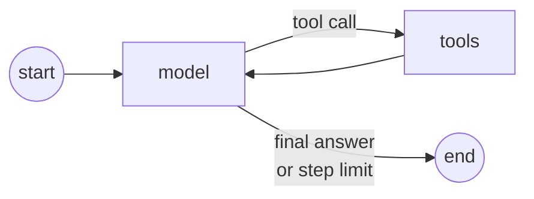

# agents

The agent: a LangGraph graph with two nodes.

| File | Does |
|---|---|
| `graph.py` | builds the graph: `model` and `tools` nodes and the edges between them |
| `nodes.py` | `call_model`, `run_tools` (one call at a time, logged) and `route` |
| `runner.py` | `run(ticket_id, db)`: runs the graph, returns a `RunResult` |
| `state.py` | the graph state and `RunResult` |
| `prompts.py` | the system prompt and the first message of every run |

The graph knows nothing about refunds. It moves messages between the model and the tools, so the model can
be swapped and the tools wrapped by AgentTrust without changing it.
