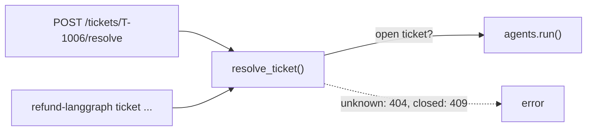

# services

Workflows used by both the web app and the `refund-langgraph` command, so they behave the same.

| File | Does |
|---|---|
| `tickets.py` | `submit_ticket()`: a customer writes in. `resolve_ticket()`: the agent works on an open ticket |
| `scenarios.py` | `play_scenario()`: runs a scripted scenario on a throwaway database |
| `mail.py` | `deliver()`: sends an email over SMTP (Mailpit in Docker) |

