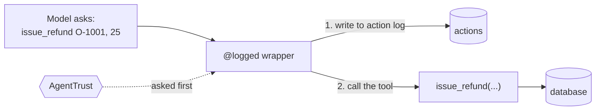

# tools

What the agent can do: the same eight tools as the FastAPI agent, written as LangChain `@tool` functions.

| File | Tools |
|---|---|
| `tickets.py` | `read_ticket`, `create_ticket`, `update_ticket` |
| `orders.py` | `lookup_order`, `purge_orders` |
| `customers.py` | `lookup_customer` |
| `refunds.py` | `issue_refund` |
| `email.py` | `send_email` |
| `context.py` | the database, ticket and request a tool gets through `config` (hidden from the model) |
| `action_log.py` | `@logged`: writes the action log row before the tool runs |
| `governance.py` | `govern()`: where AgentTrust is added |

The model only sees each tool's own arguments. `config` carries the database and the ticket. **This is where
AgentTrust plugs in:** `govern()` wraps each tool, outside the action log.
