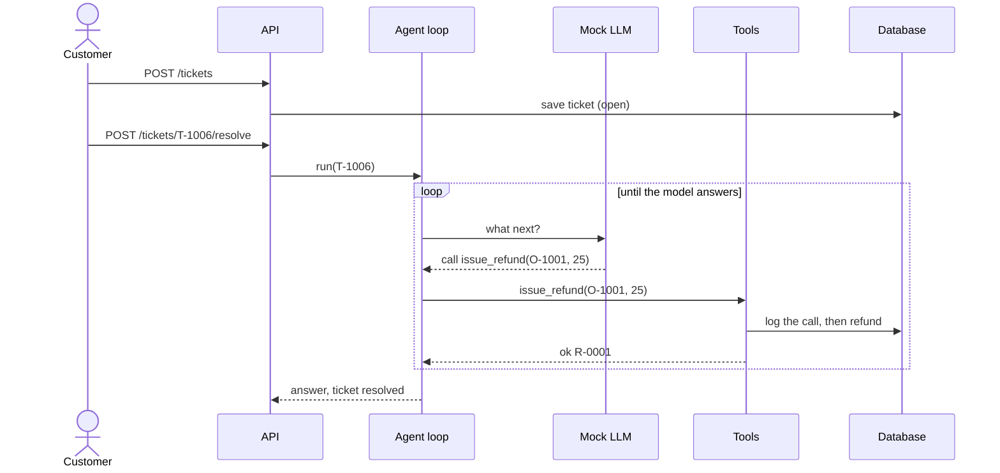

# Refund Bot (plain Python)

The support agent as a small FastAPI app. A ticket comes in, the agent works through it with tools, and the
database records what really happened.

## Run it

**On your machine.** Data goes into a local SQLite file, `refund_bot.db`.

```
uv sync
uv run refund-bot ticket "My mug arrived chipped. Please refund \$25." --customer C-1 --order O-1001
uv run refund-bot tickets                 # list tickets
uv run refund-bot run over_limit          # play a scripted scenario
uv run refund-bot reset                   # back to the starting data
uv run refund-bot serve                   # web app on http://localhost:8000/docs
uv run pytest
```

**With Docker** (from the repo root). Adds Postgres and Mailpit:

```
docker compose up -d --wait
docker compose logs -f python             # watch the agent work
```

| Service | Where |
|---|---|
| App and API docs | <http://localhost:8000/docs> |
| Mailpit (sent emails) | <http://localhost:8025> |
| Postgres | `localhost:5432`, user/password/database `refund` |

## Follow one ticket

```
curl -s -X POST localhost:8000/tickets -H 'Content-Type: application/json' \
  -d '{"customer_id":"C-1","order_id":"O-1001","body":"My mug arrived chipped. Please refund $25."}'
curl -s -X POST localhost:8000/tickets/T-1006/resolve     # the agent works on it
curl -s "localhost:8000/actions?ticket_id=T-1006"         # what really ran
```

What happens inside:



## The API

| Request | Does |
|---|---|
| `POST /tickets` | a customer writes in |
| `GET /tickets?status=open` | list tickets |
| `POST /tickets/{id}/resolve` | the agent resolves a ticket |
| `GET /orders`, `/customers`, `/refunds`, `/emails` | look at the data |
| `GET /actions?ticket_id=…` | the action log: every tool call |
| `POST /reset` | back to the starting data |
| `POST /scenarios/{id}/run` | play a scripted scenario on a throwaway database |

Errors always look like `{"error": "..."}`.

## Settings

| Variable | Default | |
|---|---|---|
| `DATABASE_URL` | `sqlite:///refund_bot.db` | Postgres in Docker |
| `SMTP_HOST` | empty: emails stay in the database | `mailpit` in Docker |
| `LOG_LEVEL` | `INFO` | `DEBUG` adds each tool's full result |

## Where things are

The code lives in [`app/`](app/). Each folder has its own short README.

```
app/
├── main.py, cli.py    the web app and the refund-bot command
├── api/, schemas/     endpoints and their request/response shapes
├── agents/            the loop that runs the agent
├── llm/               the mock LLMs
├── tools/             what the agent can do  ← AgentTrust plugs in here
├── services/          workflows shared by the API and the command
├── repositories/      small database functions
├── db/                tables, connection, starting data
└── core/              settings and logging
alembic/               database migrations (run automatically on start)
tests/
```
