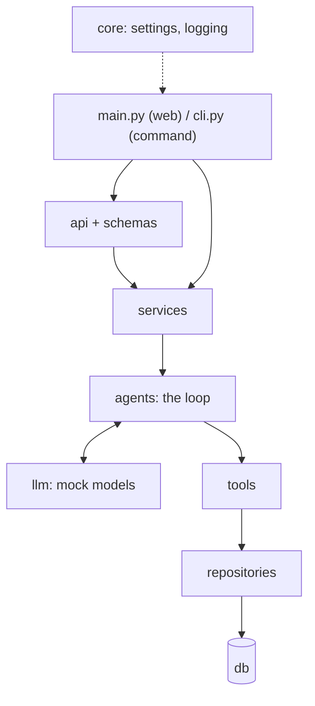

# app

The Refund Bot's code. Each layer only talks to the one below it.

**Start reading here:**
1. [`agents/support_agent.py`](agents/support_agent.py): the loop, about 50 lines.
2. [`tools/`](tools/): the eight things the agent can do.
3. [`llm/rules.py`](llm/rules.py): how the mock model decides.
