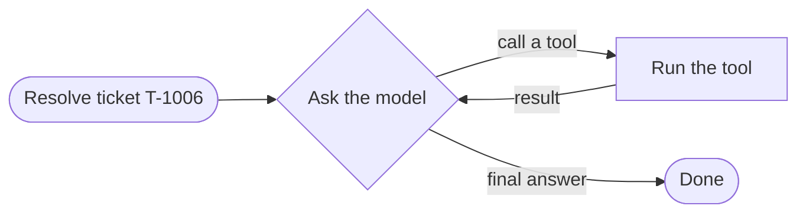

# agents

The agent itself: a loop that passes messages between the model and the tools.

| File | What it has |
|---|---|
| `support_agent.py` | `run()`: the loop. `call_tool()`: runs one tool, turns a crash into an `ERROR` result |
| `prompts.py` | what the agent is told |
| `state.py` | `RunResult`: the answer, the ticket, the action log, any tickets it created |

The loop knows nothing about refunds. Swap the model or wrap the tools, and this file stays the same. It stops
after 10 steps as a safety net.
