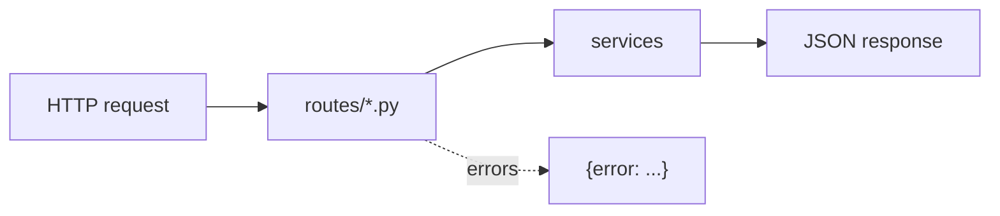

# api

The web endpoints, one file per group in `routes/`. Routes check input and call a service. They hold no
business logic.

| File | Endpoints |
|---|---|
| `routes/tickets.py` | `/tickets`, `/tickets/{id}`, `/tickets/{id}/resolve` |
| `routes/data.py` | `/orders`, `/customers`, `/refunds`, `/emails`, `/actions`, `/reset` |
| `routes/scenarios.py` | `/scenarios`, `/scenarios/{id}/run` |
| `routes/health.py` | `/health` |

With the app running, <http://localhost:8000/docs> lets you try every endpoint.
