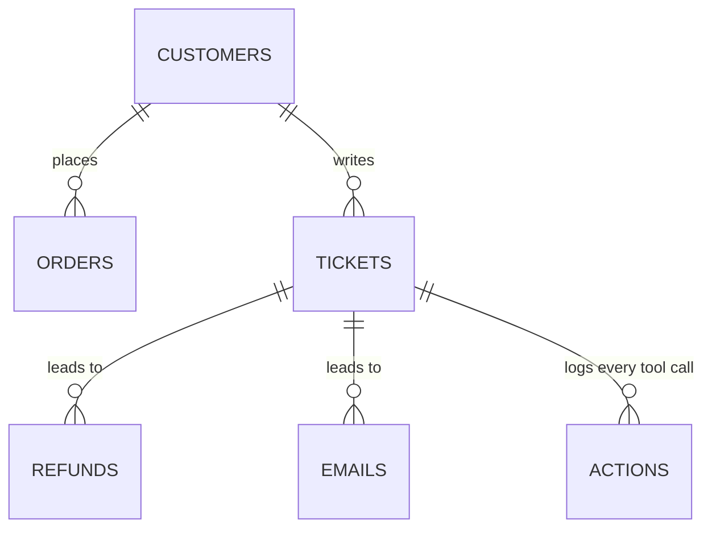

# db

The database: six tables, the connection, and the starting data.



| File | Does |
|---|---|
| `models.py` | the tables |
| `session.py` | connects to `DATABASE_URL` and updates the tables on start |
| `seed.py` | the starting data (3 customers, 4 orders, 5 tickets) and `reset_database()` |

It uses SQLite by default (nothing to install) and Postgres in Docker. A refund is paid once per ticket, order
and amount.

**Changing a table:** edit `models.py`, then run:

```
uv run alembic revision --autogenerate -m "describe the change"
```
