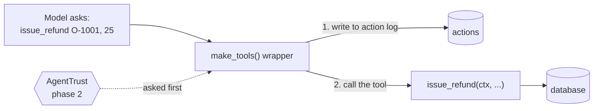

# tools

What the agent can do. These are eight plain functions, grouped by subject.

| File | Tools |
|---|---|
| `tickets.py` | `read_ticket`, `create_ticket`, `update_ticket` |
| `orders.py` | `lookup_order`, `purge_orders` |
| `customers.py` | `lookup_customer` |
| `refunds.py` | `issue_refund` |
| `email.py` | `send_email` |

Every call goes through `make_tools()` in `__init__.py`:

The wrapper hides the database from the model and logs every call before it runs. That log is the proof of
what really happened. **This is where AgentTrust plugs in:** it gets asked before each tool runs.
